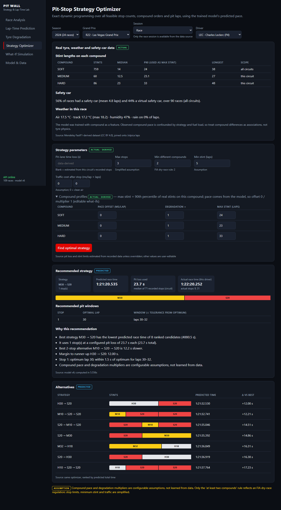

# F1 Race Strategy & Lap-Time Prediction

An end-to-end, reproducible application that ingests real Formula 1 race data, stores it in PostgreSQL, trains a
lap-time model with calibrated uncertainty, estimates tyre degradation, finds the optimal pit strategy with exact
dynamic programming, and compares strategies with a Monte Carlo what-if simulator – all behind a FastAPI backend and a
React dashboard.

> **Honesty first.** The only accessible free source (Jolpica-F1) has **no tyre-compound or weather data**. The app
> never fakes it: compound behaviour in the optimizer is an *editable, labelled assumption*, weather is an empty
> state, and every chart/number is tagged **ACTUAL / PREDICTED / SIMULATED** with its source. Read
> [LIMITATIONS](docs/LIMITATIONS.md) and [MODEL_EVALUATION](docs/MODEL_EVALUATION.md) before judging the numbers.



## Pipeline

```
Jolpica-F1 API → ingestion (paged, cached, idempotent) → PostgreSQL → features → quantile GBM + conformal intervals
   → pace table (lap × tyre age) → DP strategy optimizer → Monte Carlo simulator → FastAPI → React dashboard
```

## Workflows

| | Workflow | Page | Output kind |
|---|---|---|---|
| A | Historical race analysis (lap times, positions, pit stops, driver comparison) | Race Analysis | actual |
| B | Lap-time prediction with 80 % interval, predicted-vs-actual on the race | Lap-Time Prediction | predicted + actual |
| C | Tyre degradation from lap time vs tyre age | Tyre Degradation | actual (regression) |
| D | Pit-strategy optimisation, windows, explanation, alternatives | Strategy Optimizer | predicted |
| E | What-if Monte Carlo: strategies × safety car × weather | What-If Simulation | simulated |
| – | Model registry, metrics, data availability | Model & Data | actual |

Screenshots (real data): [analysis](docs/screenshots/01-analysis.png), [prediction](docs/screenshots/02-predict.png),
[degradation](docs/screenshots/03-degradation.png), [optimizer](docs/screenshots/04-optimize.png),
[simulation](docs/screenshots/05-simulate.png), [models](docs/screenshots/06-models.png).

## Results (real, held-out future races)

Model v4 trained on 73 races (2021–2024) and tested on the last four races of 2024:
MAE **3,034 ms** vs **3,281 ms** circuit-median baseline; 80 % interval coverage **0.65** (target 0.80); the dry
races have MAE 0.8–2.0 s, the wet São Paulo race 8.2 s. Details and caveats: [MODEL_EVALUATION](docs/MODEL_EVALUATION.md).

Measured latency (local, laptop, SQLite, 2 seasons): list/laps ≈ 0.3 s, prediction ≈ 0.35–0.45 s, optimise ≈ 1.5–2.5 s
(≈ 0.9 s compute), simulate 5k–20k runs ≈ 0.6–0.7 s, full model training ≈ 73 s.

## Quick start

```bash
# Docker (PostgreSQL + backend + frontend on :8080)
cp .env.example .env
docker compose up --build
docker compose --profile tools run --rm ingest     # real data from Jolpica-F1 (SEASON=2024)
docker compose --profile tools run --rm train

# Without Docker
cd backend && python -m venv .venv && .venv/Scripts/pip install -r requirements.txt -r requirements-dev.txt
export F1_DATABASE_URL=sqlite:///data/dev.db
python -m app.cli migrate && python -m app.cli ingest --season 2024 && python -m app.cli train
uvicorn app.main:app --port 8000
cd ../frontend && npm ci && npm run dev            # http://localhost:5173
```
See [DEPLOYMENT](docs/DEPLOYMENT.md) and the [demo walkthrough](docs/DEMO.md).

## Tests

pytest (unit, ingestion, ML, strategy, simulation, API/DB), vitest component tests, Playwright E2E, ruff, mypy, oxlint;
CI runs all of them on PostgreSQL. See [TESTING](docs/TESTING.md) and the [acceptance report](docs/ACCEPTANCE_REPORT.md).

## Documentation

[System architecture](docs/SYSTEM_ARCHITECTURE.md) · [Database schema](docs/DATABASE_SCHEMA.md) ·
[Data sources](docs/DATA_SOURCES.md) · [Model methodology](docs/MODEL_METHODOLOGY.md) ·
[Strategy engine](docs/STRATEGY_ENGINE.md) · [Simulation](docs/SIMULATION_METHODOLOGY.md) ·
[Model evaluation](docs/MODEL_EVALUATION.md) · [API](docs/API_DOCUMENTATION.md) · [Testing](docs/TESTING.md) ·
[Limitations](docs/LIMITATIONS.md) · [Deployment](docs/DEPLOYMENT.md) · [Demo](docs/DEMO.md) · [Acceptance report](docs/ACCEPTANCE_REPORT.md)

## Repository layout

```
backend/   FastAPI app, ingestion, ML, strategy engine, Alembic, tests, Dockerfile
frontend/  React + TypeScript + Vite dashboard, vitest tests, Playwright E2E
docs/      documentation, diagrams, screenshots
.github/   CI workflow
docker-compose.yml
```

Data is fetched by you from a public community API and is not redistributed here (`backend/data/` is git-ignored).
No team logos or proprietary assets are used. "F1" is used descriptively; this project is unaffiliated with Formula 1.
