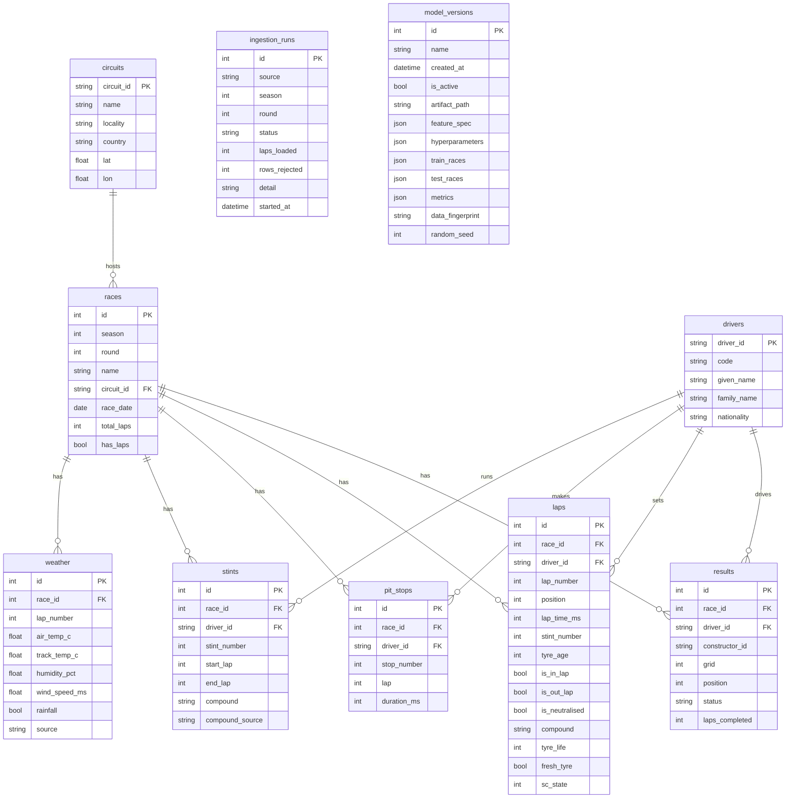

# Database Schema

PostgreSQL 16 in Docker/CI; SQLite for local development and the default unit-test run. The schema is created by
the Alembic migration `backend/alembic/versions/0001_initial_schema.py` and `0002_tyre_weather_fields.py` (autogenerated from the models and verified to
apply on PostgreSQL in CI). Primary keys of high-volume tables are `BIGINT` on PostgreSQL and `INTEGER` on SQLite.



## Constraints and indexes

| Table | Constraint / index | Why |
|---|---|---|
| `races` | unique `(season, round)`; index `circuit_id` (`ix_races_circuit`) | idempotent upsert; per-circuit lookups |
| `results` | unique `(race_id, driver_id)` | one classification row per driver per race |
| `laps` | unique `(race_id, driver_id, lap_number)`; index `(race_id, lap_number)`; index `race_id` | prevents duplicates; lap-range scans for a race |
| `pit_stops` | unique `(race_id, driver_id, stop_number)`; index `race_id`; FK `ON DELETE CASCADE` | per-race reload deletes and re-inserts children |
| `stints` | unique `(race_id, driver_id, stint_number)`; index `race_id`; FK cascade | same |
| `weather` | index `race_id`; FK cascade | same |
| `ingestion_runs` | index `(season, round)` | audit lookups |
| `model_versions` | index `name` | active-model lookup |

`tests/test_db.py` applies the real Alembic migration to a fresh database and asserts these constraints exist and are enforced.

## Semantics worth knowing

* `laps.tyre_age` is **laps since the driver's last pit stop** (1-based). It is a *lower bound* of true tyre age
* `laps.compound`, `laps.tyre_life` (true tyre age), `laps.fresh_tyre`, `laps.sc_state` (0 none, 1 SC, 2 VSC) and `stints.compound` come from the Mendeley dataset (migration `0002`); they are NULL for races it does not cover. `stints.compound_source` records the source.
  is reserved for a future tyre source.
* `laps.is_neutralised` is a **heuristic** (field median lap > 1.15 × the race's green-flag pace), not an official flag.
* `weather` holds one row per lap (median over drivers; rainfall = any driver) with air/track temperature, humidity, wind and rain, filled for 2022–2025 races the dataset covers; elsewhere the API returns `available: false` with the reason.
* `races.has_laps` marks races whose laps were fully ingested; the training set only uses those.
* `ingestion_runs.rows_rejected` counts lap rows dropped for invalid, duplicate or implausible times.

## Migrations

```bash
cd backend
python -m app.cli migrate        # alembic upgrade head
alembic revision --autogenerate -m "describe change"
```
