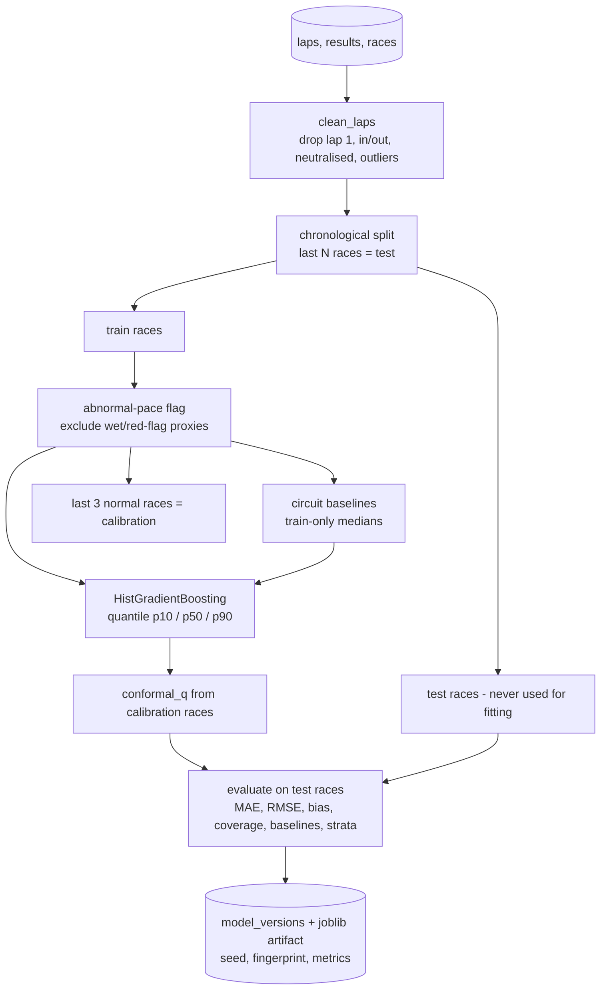

# Model Methodology

Code: `backend/app/ml/features.py`, `train.py`.

## Task
Predict a driver's **race lap time (ms)** given the race, lap number, tyre age and driver/team context, with an
uncertainty interval. (Only the Race session exists in the data – see DATA_SOURCES.)

## Data cleaning (`clean_laps`)
Keep laps with a valid time; drop lap 1, in-laps, out-laps, laps flagged neutralised (SC/VSC/red-flag heuristic), and individual outliers above 107 % of that driver's race median.
The remaining "clean" laps measure pace under green-flag running.

## Target and features
* **Target** = `lap_time − circuit_baseline`, where the baseline is the **median clean lap of the circuit computed on
  training races only** (no leakage). Predictions add the baseline back. Circuits unseen in training fall back to a global baseline and are flagged.
* **Numeric features**: `tyre_age`, `lap_number`, `race_progress` (lap / total laps, a fuel-load proxy), `grid`, `season`.
* **Categorical**: `constructor_id`, `driver_id`. An optional `compound` feature is used automatically only if ≥ 50 % of
  laps have it (currently never – no source).
* `tyre_age` = laps since the last recorded stop (a lower bound of real age).

## Model
`HistGradientBoostingRegressor` with **quantile loss** for p10, p50, p90 (hyper-parameters stored per model version:
300 iterations, lr 0.05, 31 leaves, min 40 samples/leaf, L2 = 1; fixed `random_seed = 42`).

## Validation: chronological, race-level
Races are ordered by date; the **last N races (default 4) are the test set** and never touch training, baselines or
calibration. No random lap-level split (that would leak a race's pace into its own test laps).

## Abnormal-pace races (wet / red-flag proxy)
A race is flagged (in addition to rainfall / wet tyres on > 10 % of laps where weather data exists) when its median clean lap exceeds **1.06 ×** the circuit's
reference pace (median of per-race medians; needs ≥ 2 races at the circuit). Flagged races are excluded from
training/calibration and reported as a separate stratum. Circuits with fewer than 2 races in the training data cannot be classified. On the current data the rule excludes 4 training races and flags the wet São Paulo 2024 test race; it is a coarse proxy, not a weather model.

## Interval calibration (split conformalised quantile regression)
Raw p10–p90 intervals under-cover on new races. The last 3 non-abnormal **training** races (held out from fitting) are
used to compute `conformal_q`, the 80 % quantile of the conformity score `max(p10 − y, y − p90)`; both ends are
widened by `conformal_q`. This improves but does not guarantee coverage on unseen races (distribution shift).

## Registry and reproducibility
Each training run writes a joblib artifact and a `model_versions` row: feature spec, hyper-parameters, train/test/calibration
race ids, metrics, **random seed**, and a **data fingerprint** (hash of the training rows). Same data + seed ⇒ same model (tested).

## ML workflow

