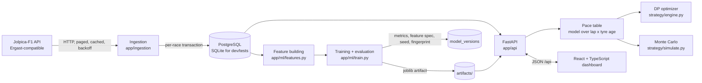
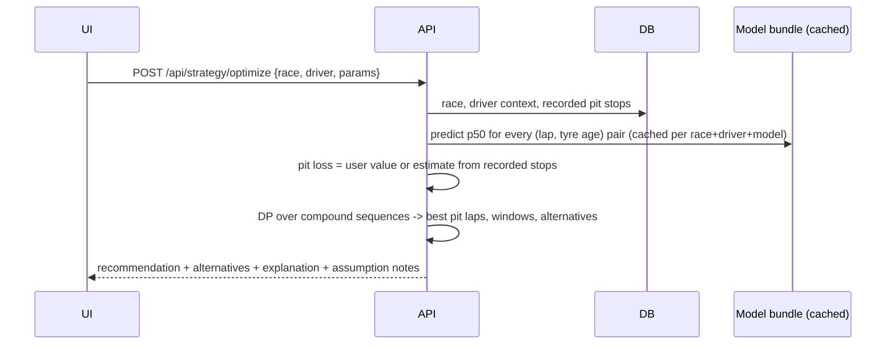

# System Architecture

## Overview

Every number the UI shows is read from the database or computed by the API from database rows. There is no mocked
data path in the application code; the only synthetic data lives in `backend/tests` and is used by automated tests.

## Components

| Layer | Module | Responsibility |
|---|---|---|
| Ingestion | `app/ingestion/jolpica.py` | HTTP client: pagination (100 rows/page), throttling, exponential back-off on 429/5xx, on-disk raw JSON cache |
| | `app/ingestion/transform.py` | Parse times, derive stints/tyre age/in-out laps, flag neutralised laps, reject invalid rows |
| | `app/ingestion/pipeline.py` | Idempotent per-race ingestion, `ingestion_runs` audit, failures recorded not raised |
| Persistence | `app/models.py`, `alembic/` | SQLAlchemy 2.0 models, one Alembic migration |
| ML | `app/ml/features.py`, `train.py` | Cleaning, features, chronological split, quantile GBM, conformal calibration, registry |
| Analytics | `app/analysis.py` | Pit-loss estimation, tyre-degradation regression |
| Strategy | `app/strategy/engine.py`, `simulate.py`, `config.py` | Exact DP optimizer, pit windows, explanations, Monte Carlo |
| API | `app/api/routes.py`, `schemas.py`, `services.py`, `main.py` | Validation (Pydantic v2), caching, error handlers, request logging |
| UI | `frontend/src` | Six pages, one per workflow plus model/data page |

## Request flow: optimisation

## Design decisions

* **Database is the source of truth.** The API never reads the raw JSON cache; ingestion is the only writer of race data.
* **Model and strategy are separated.** The ML model predicts pace as a function of lap and tyre age. The optimizer
  consumes a pace *table*, so it works with any model and is testable with hand-built tables.
* **Assumptions are first-class.** Compound behaviour, minimum stint, traffic and safety-car parameters are request
  parameters with documented defaults and are labelled `ASSUMPTION` in the UI and API output.
* **Caching.** `cachetools.LRUCache` for loaded model bundles and per-(race, driver, model) pace tables; raw HTTP responses are cached on disk during ingestion.
* **Serving threads.** `threadpool_limits(1)` at start-up: measured multi-second latency from OpenMP oversubscription when requests overlapped (cold request 10 s → 1.9 s, warm 0.26 s).
* **Observability.** `structlog` JSON/console logs, per-request id and latency, ingestion audit table.

## Failure handling

| Situation | Behaviour |
|---|---|
| Database unreachable | `/api/health` reports `database: down`; other routes return 500 with a message, UI shows an error banner |
| No trained model | prediction/optimise/simulate return **503** with an explanation; UI shows the message (no fabricated output) |
| Race without laps | 404 / empty state |
| Source API throttles | back-off and retry; a failing race is recorded in `ingestion_runs` and the run continues |
| Invalid input | 422 with field-level messages; UI also validates before sending |
